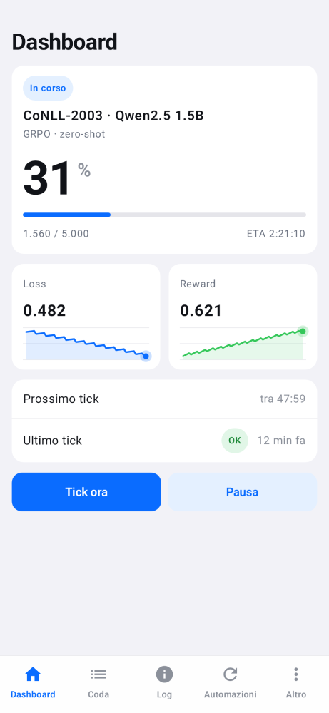
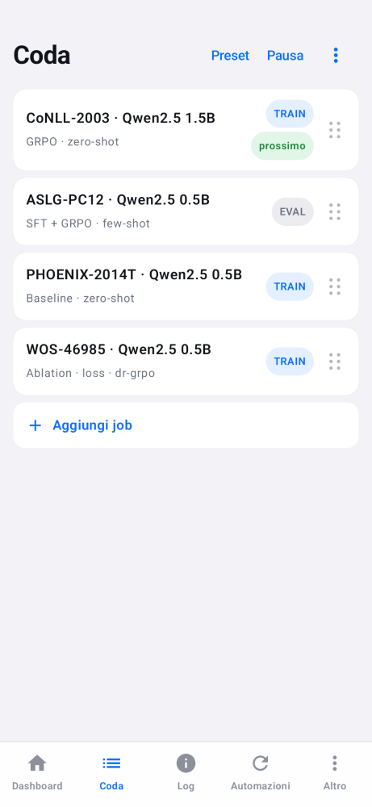
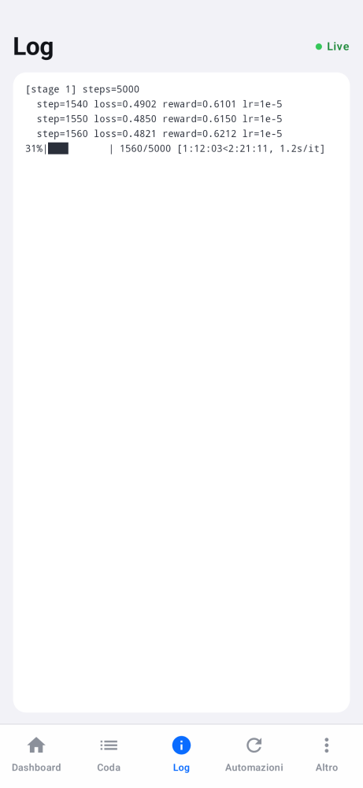
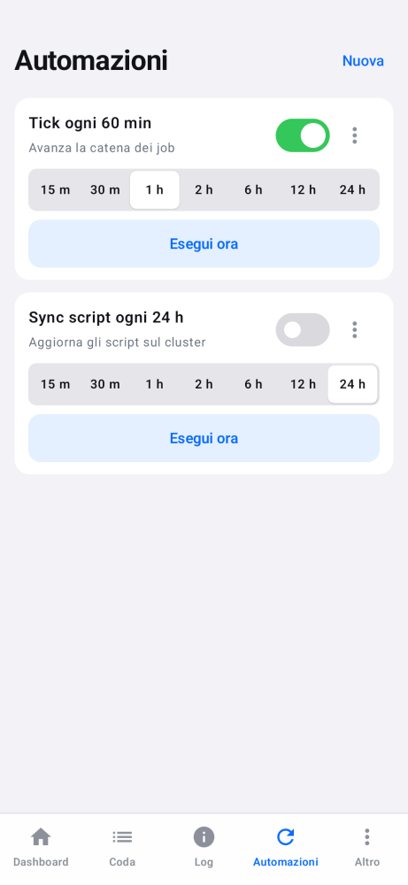

# ClusterControl

Android app to drive a SLURM job chain on a university GPU cluster from a phone: tick the chain, manage the
queue (drag and drop), watch the active job, keep the cluster scripts up to date. Personal tool, built for the
[neuro_symbolic_t2g](https://github.com/GiuseppeBellamacina/neuro_symbolic_t2g) pipeline, whose
`cluster/cluster_helper.sh` and `cluster/presets.yaml` it uses.

The cluster accepts ssh only from the university network. The app reaches it through the university SSTP VPN,
implemented in userspace: the tunnel exists only while the app talks to the cluster and carries nothing else, so
the rest of the phone never goes through the VPN.

## Screenshots

<p>
  
  
  
  
</p>

Rendered on the JVM with sample data (Paparazzi), not taken from a device.

## Features

- **Dashboard**: active job (train/eval, queue size) with big completion %, live ETA, loss/reward charts, countdown to the next tick, last tick result.
- **Queue**: drag and drop reorder, swipe to delete with undo, add jobs or presets from a sheet, pause, kill.
- **Log**: raw log of the active job.
- **Automations**: tick or script sync on an interval (WorkManager, 15 min minimum), also with the app closed. Exclude the
  app from battery optimization when asked, otherwise Android may skip them. Only a real credential rejection suspends
  the automations; timeouts and network errors just wait for the next slot.
- **Configuration**: Altro > Configurazione is where everything is entered: cluster host, ssh port, project folder, ssh
  user and key (typed, pasted or picked from a file), VPN on/off with its host, user and password, GitHub repo and
  branch. Nothing about a specific cluster or account is built into the app; all of it is stored encrypted on the
  phone (AndroidX EncryptedSharedPreferences, key in the Android Keystore, no backups). Blank secret fields keep the
  stored value. Without the VPN switch the app connects directly.
- **Security**: Altro > Sicurezza locks the app behind fingerprint, face or the screen PIN (on at launch and after 30
  seconds away). The lock guards the screens only: scheduled ticks keep running in the background. The build is not
  debuggable. If the phone has no screen lock the app cannot lock itself.
- **Updates**: Altro > Aggiornamenti checks the latest GitHub release, downloads the apk (checksum verified) and hands it
  to the system installer.
- **Notifications**: a failed scheduled tick or sync, each job that ends (done or failed), and when every job is finished.
- **Sync**: keeps the cluster identical to the GitHub repo for what it needs to run (the `.py` files of `src/`, the `.sh`
  scripts of `cluster/`, `experiments/configs/*.yaml`, `main.py`, `pyproject.toml`), the same set as `sync_cluster.ps1`.
  It compares git blob ids (one tree request plus one command on the cluster, nothing is downloaded; line endings are
  ignored except for shell scripts), shows only what differs or "all up to date", and uploads only that. Results, figures and other files are never sent. Code files are not
  touched by scheduled syncs while a job is running.
- **More**: connection check (VPN, ssh, cluster), history of every operation, updates, configuration, security.
- While the app is open it keeps one tunnel and one ssh session alive and refreshes every few seconds;
  in the background it opens short-lived sessions only for scheduled runs.

## Monitoring: the training reports its own progress

The app does not parse logs. The job writes its state with [runstatus](https://github.com/GiuseppeBellamacina/runstatus)
(`run_status/<jobid>.json` plus `<jobid>.series.json`, in a folder of their own next to the SLURM logs); the project's
`cluster/cluster_helper.sh` hands them over as `RUN_STATUS` (monitor) and `TS_SERIES` (charts). The Dashboard shows
progress and live ETA (the total comes from the trainer, never above 100%), loss and reward charts, the reward of every
component of an RL run with its own chart, the other metrics the job reports (learning rate, gradient norm, KL, lengths,
GPU memory) and, for an evaluation, its final scores. The Log tab has a second page with the latest completions: prompt,
output, gold and the reward of each component. To monitor your own training, add the runstatus callback to it (3 lines,
see that README); the raw log is only shown in the Log tab. A job that writes no runstatus file shows no progress.

## Modules

| Module | What |
| --- | --- |
| `core` | JVM library: helper protocol, log parsing, config catalog, presets, script sync, ssh client (JSch) |
| `sstp` | JVM library: SSTP + PPP (MS-CHAPv2) + a minimal TCP stack, exposed as a `java.net.Socket` |
| `app` | Android app (Kotlin, Jetpack Compose, light "A" style) |

## Build (Docker only, nothing is installed on the host)

```powershell
.\build.ps1            # debug-signed APK -> dist\clustercontrol-debug.apk
.\test.ps1             # unit tests of core and sstp
.\integration.ps1 -ProjectRepo <checkout of the project>   # core against a throwaway sshd + the project's real cluster scripts (fake SLURM)
.\release.ps1 -Publish -Notes "..."   # build, git tag + GitHub release with the apk
```

The APK carries no credentials or endpoints: after installing it, open Altro > Configurazione and enter them. Every
build is signed with the debug key kept in the `cc-android-home` Docker volume, so Android installs a newer APK (or a
release from Altro > Aggiornamenti) over the installed app; lose the volume and you must reinstall once.

The "project folder" you enter must be the one the cluster scripts themselves use (`PROJ_DIR` in `cluster/_lib.sh`).
The project layout the app expects is the one of the t2g pipeline: `cluster/cluster_helper.sh` on the cluster and, in the
repo, `cluster/*.sh`, `src/`, `experiments/configs/`, `cluster/presets.yaml`.

`sstp-lab.ps1` and `sstp-e2e.ps1` exercise the tunnel against the real VPN server (one login per run, credentials
via `docker --env-file`).

## Limits

- One TCP flow per tunnel, no proactive SSTP echo, no reconnection inside a tunnel (the app reconnects).
- Doze makes scheduled runs approximate. UI behaviours (gestures, lifecycle) were only checked with JVM screenshots,
  not on a device farm.
